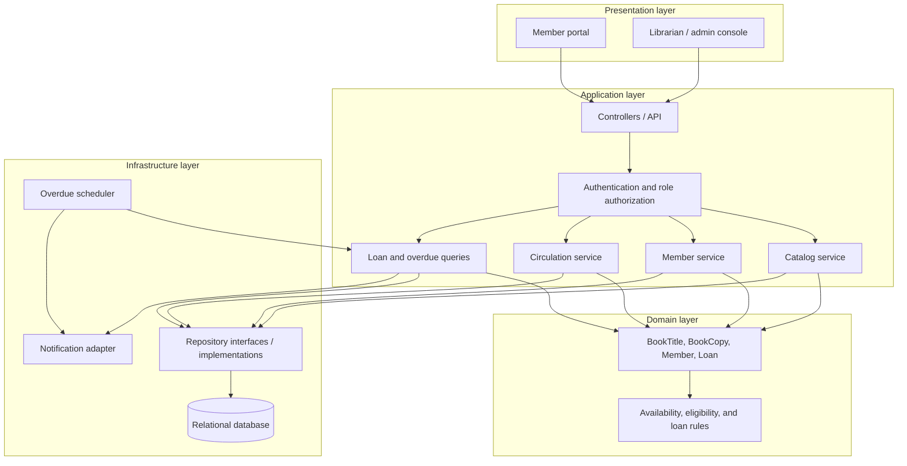
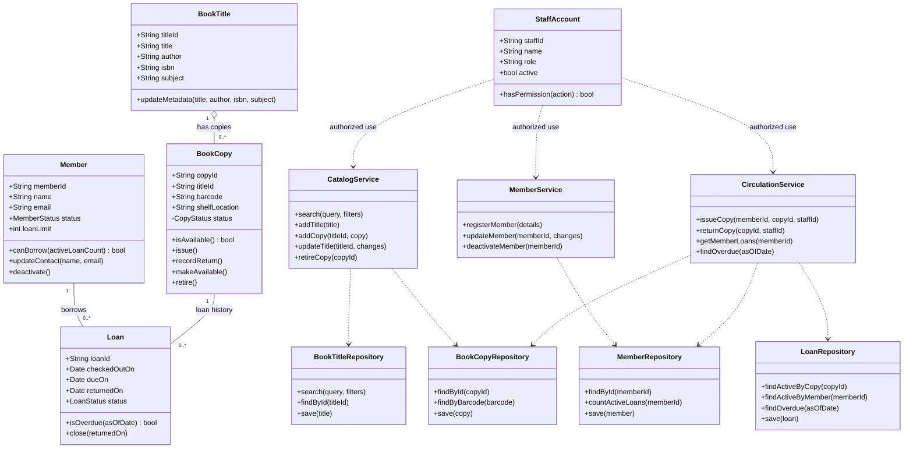
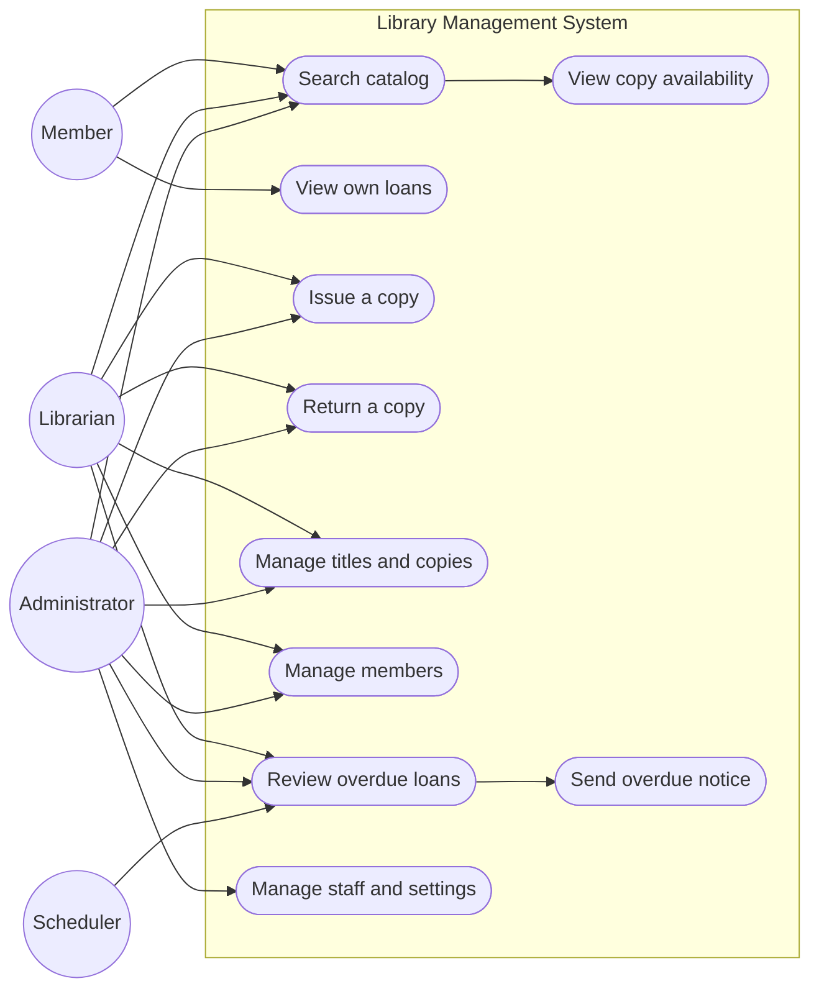
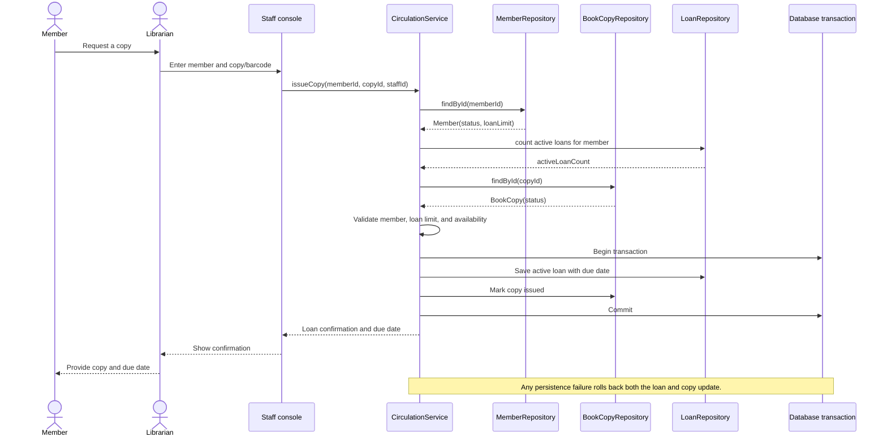
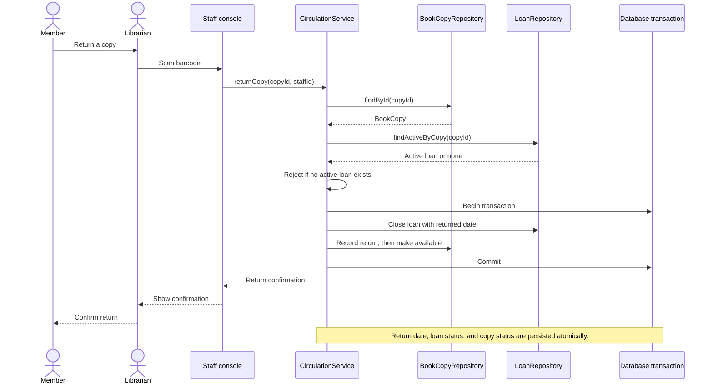
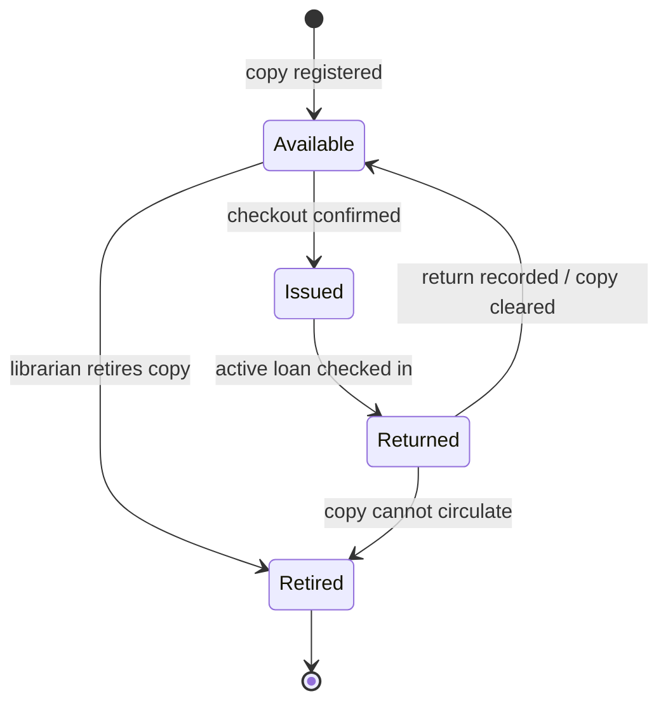
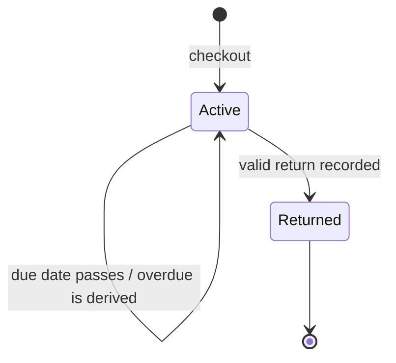
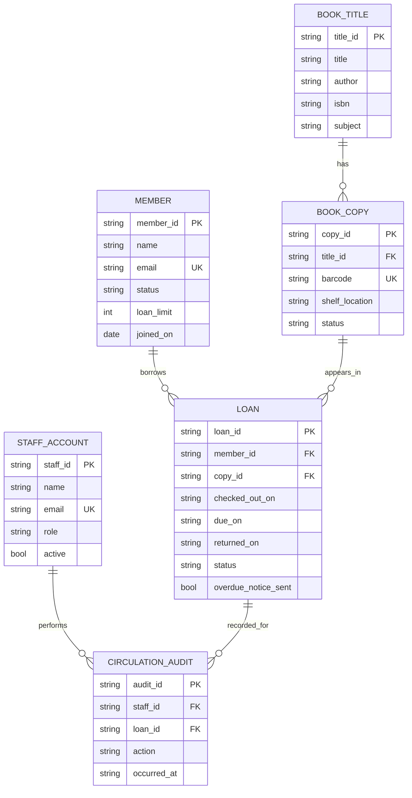
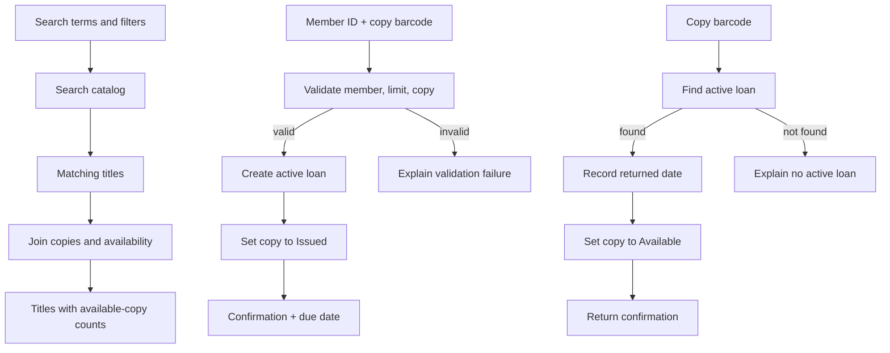

# Library Management System — OOA and Architecture Design

## 1. Purpose and scope

This document models a small library system before implementation. It covers catalog search, member and catalog administration, circulation, and overdue tracking. It is an analysis and design artifact, not a complete application specification.

### Assumptions

- A catalog title can have several individually tracked physical copies. A copy, not a title, is issued to a member.
- Members can search the catalog; a librarian confirms checkouts and records returns.
- A member must be active and below the configured active-loan limit to borrow.
- Each copy can have at most one active loan. Loan duration and loan limit are library configuration.
- Overdue status is derived from an active loan's due date; no fines, reservations, payments, or inter-library transfers are in scope.
- Admin is a privileged librarian role that can manage staff, members, and catalog records.

## 2. Actors and requirements

### Actors

| Actor | Goal |
| --- | --- |
| Member | Search the catalog and see whether copies are available; review their active and past loans. |
| Librarian | Register or update members, maintain title and copy records, issue books, accept returns, and review overdue loans. |
| Administrator | Perform librarian tasks and manage staff access and library-wide settings. |
| Scheduler | Periodically identify overdue active loans and request notifications. |

### Main use cases

| Use case | Primary actor | Preconditions and outcome |
| --- | --- | --- |
| Search catalog | Member, Librarian | Search by title, author, ISBN, or subject; results include copy availability. |
| View member loans | Member, Librarian | A member sees their own loans; a librarian may look up a member's loans. |
| Issue a book | Librarian | Member is active, has capacity, and a copy is available; an active loan is created and the copy becomes issued. |
| Return a book | Librarian | An active loan is identified; the loan is closed and the copy becomes available after return processing. |
| Manage catalog | Librarian | Create or update a title and its physical copies; retire a copy only when it has no active loan. |
| Manage members | Librarian | Register, update, or deactivate a member; a member with an active loan cannot be deactivated. |
| Review overdue loans | Librarian, Scheduler | List active loans past their due date; scheduler requests a notice once per overdue loan. |
| Manage staff and settings | Administrator | Manage staff permissions and configure loan duration and loan limit. |

### Business rules

1. Checkout requires an active member, an available copy, and remaining member borrowing capacity.
2. Checkout must atomically create one active loan and mark its copy issued. A failure must leave both unchanged.
3. Return requires an active loan for the copy being returned. It records the return date and makes that copy available.
4. A copy with an active loan cannot be deleted or issued again.
5. A member can inspect only their own loan history unless the requester is a librarian or administrator.
6. Overdue means `loan.status = ACTIVE` and `today > loan.dueOn`. A notice is sent at most once for each loan.

## 3. High-level architecture

The application uses a layered design. The user interfaces depend on application services; services enforce use-case and domain rules; repositories isolate persistence. The scheduler uses the same service and notification boundary as interactive workflows.



### Component responsibilities

| Component | Responsibility |
| --- | --- |
| Member portal | Search and display catalog availability and the signed-in member's loans. |
| Librarian/admin console | Provide protected workflows for circulation, catalog, member, staff, and settings management. |
| Controllers and authorization | Validate requests, establish identity and role, invoke services, and map results/errors to the UI or API. |
| Application services | Orchestrate use cases and transaction boundaries; do not contain persistence details. |
| Domain entities | Protect state and enforce local invariants, such as legal copy and loan transitions. |
| Repositories | Load and persist entities; expose query operations needed by services. |
| Relational database | Persist catalog, copies, members, loans, staff, and audit history with referential integrity. |
| Overdue scheduler and notification adapter | Find overdue active loans and deliver a notice through a replaceable email/in-app adapter. |

## 4. Object-oriented model

### Class diagram



`BookTitle` stores shared bibliographic information; `BookCopy` represents one physical, independently borrowable item. A `Loan` is the historical association between one member and one copy. Staff authorization is checked at the application boundary and is not delegated to UI visibility.

### Use-case diagram



### Sequence: issue a book



### Sequence: return a book



## 5. Behavioral model

### Book-copy state diagram

The `Returned` state represents the short return-processing step. After the item is checked in and cleared for circulation, it becomes `Available`. A damaged or missing copy should instead be taken out of circulation; that optional operational state can be added if required.



### Loan lifecycle



An overdue loan remains active until returned; overdue is a date-based condition, not a terminal loan state. This avoids separate overdue state updates becoming inconsistent with the due date.

## 6. Data, functional, and behavioral models

### Data model



**Integrity constraints**

- `BOOK_COPY.title_id`, `LOAN.member_id`, and `LOAN.copy_id` reference existing rows.
- `BOOK_COPY.barcode` and account email addresses are unique.
- At most one `LOAN` per copy may have `status = ACTIVE`; enforce with a database constraint/index where supported and a transaction/locking strategy.
- `LOAN.due_on >= LOAN.checked_out_on`; if returned, `returned_on >= checked_out_on`.
- Store dates consistently (date-only for circulation dates, timestamp for audit events).
- Keep loan history when a copy or member is retired/deactivated; use status changes rather than deleting historical records.

### Functional model



### Key operation contracts

| Operation | Input | Success result | Rejection conditions |
| --- | --- | --- | --- |
| `searchCatalog(query, filters)` | Text and optional author/subject/availability filters | Matching titles, copy counts, and availability | Invalid filter format |
| `issueCopy(memberId, copyId, staffId)` | Member, physical copy, authenticated staff | New active loan and due date | Unknown/inactive member, loan limit reached, unknown/unavailable copy, unauthorized staff |
| `returnCopy(copyId, staffId)` | Physical copy and authenticated staff | Closed loan and available copy | Unknown copy, no active loan, unauthorized staff |
| `deactivateMember(memberId)` | Member identifier and authenticated staff | Member status set inactive | Unknown member or active loan exists |
| `findOverdue(asOfDate)` | Evaluation date | Active loans whose due date has passed | Invalid evaluation date |

## 7. Abstraction to implementation

The following JavaScript-style sketch demonstrates encapsulated copy-state transitions. Production checkout and return operations must persist all related changes within one database transaction.

```js
const CopyStatus = Object.freeze({
  AVAILABLE: "AVAILABLE",
  ISSUED: "ISSUED",
  RETURNED: "RETURNED",
  RETIRED: "RETIRED",
});

class BookCopy {
  #status = CopyStatus.AVAILABLE;

  constructor({ copyId, titleId, barcode, shelfLocation }) {
    if (!copyId || !titleId || !barcode) {
      throw new TypeError("copyId, titleId, and barcode are required");
    }

    this.copyId = copyId;
    this.titleId = titleId;
    this.barcode = barcode;
    this.shelfLocation = shelfLocation;
  }

  get status() {
    return this.#status;
  }

  isAvailable() {
    return this.#status === CopyStatus.AVAILABLE;
  }

  issue() {
    if (!this.isAvailable()) {
      throw new Error("Only an available copy can be issued");
    }
    this.#status = CopyStatus.ISSUED;
  }

  recordReturn() {
    if (this.#status !== CopyStatus.ISSUED) {
      throw new Error("Only an issued copy can be returned");
    }
    this.#status = CopyStatus.RETURNED;
  }

  makeAvailable() {
    if (this.#status !== CopyStatus.RETURNED) {
      throw new Error("Only a returned copy can become available");
    }
    this.#status = CopyStatus.AVAILABLE;
  }

  retire() {
    if (this.#status === CopyStatus.ISSUED) {
      throw new Error("An issued copy cannot be retired");
    }
    this.#status = CopyStatus.RETIRED;
  }
}
```

Application-service pseudocode for checkout:

```text
issueCopy(memberId, copyId, staffId):
    require staffId has permission "issue"
    begin database transaction
    member = members.findByIdForUpdate(memberId)
    copy = copies.findByIdForUpdate(copyId)
    activeCount = loans.countActiveForMember(memberId)
    require member exists and member.status is ACTIVE
    require member.canBorrow(activeCount)
    require copy exists and copy.isAvailable()
    loan = Loan(member, copy, today, today + configuredLoanPeriod)
    copy.issue()
    loans.save(loan)
    copies.save(copy)
    commit transaction
    return loan
```

The corresponding `returnCopy` operation should lock/load the copy and its active loan, record the return date, transition the copy through `Issued -> Returned -> Available`, save both changes, and commit. If any validation or persistence step fails, roll back and surface an actionable error to the librarian.

## 8. Quality and security considerations

- Enforce role checks in application services or controllers, never only in the user interface.
- Use parameterized database queries and validate all user-supplied identifiers, search filters, dates, and member details.
- Use database transactions and row-level locking or equivalent safeguards to prevent two concurrent checkouts of the same copy.
- Record staff circulation actions with timestamps for operational traceability.
- Return only the member's own personal and loan data unless a staff role authorizes broader access.
- Provide clear errors for unavailable copies, loan-limit violations, duplicate barcodes, and failed transactions.
- Keep loan duration and borrowing limits as explicit configuration values rather than scattering constants through the code.
